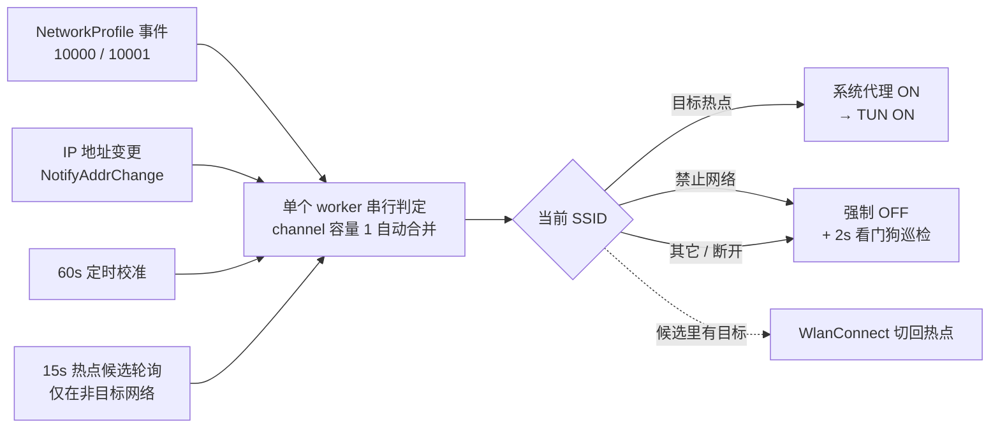

<div align="center">


**连上手机热点，自动开代理；离开热点，自动关代理。**

按当前 Wi-Fi 自动切换 Clash Verge 的 **系统代理** 与 **TUN**，事件驱动，不需要管理员权限。

<br/>

[](https://github.com/King-NO-1/clash-netwatch)
[](https://go.dev)
[](go.mod)
[](https://github.com/King-NO-1/clash-netwatch/releases)
[](https://github.com/clash-verge-rev/clash-verge-rev)
[](LICENSE)
[](https://github.com/King-NO-1/clash-netwatch/commits)

[快速开始](#五快速开始) · [工作原理](#三工作原理) · [实测数据](#四实测延迟) · [配置](#六配置) · [适用边界](#八适用场景与边界)

</div>

---

## 它到底做什么

一台电脑，两个网络：连手机热点时走代理，连校园网时绝不能留代理。

NetWatch 只干一件事——**盯住当前 Wi-Fi 是谁，把代理状态收敛到应该的样子**。

| 当前网络 | 系统代理 | TUN | 说明 |
|---|---|---|---|
| 目标热点（如 `MyPhone-5G`） | ON | ON | 自动连接成功或手动连上后立刻生效 |
| 禁止网络（如 `Campus-WiFi`） | **强制 OFF** | **强制 OFF** | 三道防线，配置、暂停、误判都绕不过 |
| 其它网络 / 断开 | OFF | OFF | 回到直连，不在任何网络上留代理 |

> [!NOTE]
> 程序只开关**本机已有的**代理软件状态，不提供、不修改任何节点或订阅，也不绕过任何网络管控。请在遵守所在网络使用规定的前提下使用。

---

## 一、为什么需要它

**Windows 自带的自动连接救不了你。** 系统只在"尚未连接"时按优先级挑网络；电脑已经挂在校园网上时，哪怕手机热点就在候选列表里，它也不会跳过去——这是系统策略，不是配置问题。

于是就有了这些日常：

- 人走了，电脑还在跑，代理挂在校园网上，直到你回来才发现；
- 手动切网络顺手关了代理，回来又忘了开，一堆任务直连跑完；
- 写个轮询脚本，3 秒一轮，切网瞬间总有几秒真空；
- 用 `netsh` 取 SSID，一次 140 ms 起步，还得多养一个进程。

NetWatch 把这件事做成一个**事件驱动的收敛器**：网络一变就判，判完就改，改完对账。

---

## 二、核心特性

| 类别 | 特性 | 怎么做到的 |
|---|---|---|
| 事件驱动 | 不做周期轮询 | 订阅 NetworkProfile 事件 + 监听 IP 地址变更，切网毫秒级唤醒 |
| 快速断开 | 离开目标网络 **305–414 ms** 完成 | 代理先关、TUN 后关，全部走内存与内核接口 |
| 三道防线 | 禁止网络下代理必关 | 判定层统一入口 + 暂停层不暂停"关" + 2 秒独立看门狗 |
| 自动切回 | 校园网连着也能跳回热点 | `WlanConnect` + 12 秒验证窗口 + 60s→10min 指数退避 |
| 开箱即用 | 下载 → 双击 → 向导 | 首次运行扫描 Wi-Fi，选三个名单即完成配置 |
| 多网络支持 | 目标 / 自动连接 / 禁止名单全可配 | 三张名单互相独立，全部用户自定义 |
| 零第三方依赖 | 纯 Go 标准库 + Win32 | `go.mod` 里没有任何 `require` |
| 免管理员 | 全程用户态 | 读 SSID、写 `HKCU`、走内核管道都不提权 |
| 轻量 | 单文件 2.9 MB，常驻 9–15 MB | `-trimpath -ldflags "-s -w"` 构建 |
| 自愈 | 被强杀 ≤1 分钟拉回 | 每分钟心跳 + 60 秒定时校准 + 外部改动自动纠偏 |

---

## 三、工作原理



两个事件源互为备份，任意一个漏了另一个会在毫秒级补上；候选轮询只负责"网络没变、但可选网络变了"这一种情况。

### 为什么不上 `netsh`

| 方案 | 取一次 SSID | 代价 |
|---|---|---|
| `netsh wlan show interfaces` | 140–165 ms | 要 spawn 一个进程 |
| `WlanQueryInterface`（wlanapi.dll） | **1–3 ms** | 零进程开销 |

500 ms 的延迟预算里，光取个 SSID 就吃掉三分之一是不可接受的。

### 执行层

- **系统代理**：直接写 `HKCU\...\Internet Settings` 的 `ProxyEnable` / `ProxyServer`，再广播 `InternetSetOption` 通知所有进程。
- **TUN**：通过 mihomo 的命名管道 `\\.\pipe\verge-mihomo-production-<hash>` 调 `PATCH /configs`，热开关，不重启内核、不提权。
- **verge.yaml 回写**：把开关状态同步回配置文件，Verge 重启或重载内核时不会翻回旧值。

### 判定规则

```
归一化（去空格 / 连字符 / 点，转小写）后比较：
  完全相等                                              → 目标网络
  fuzzy_match 且短的一方 ≥6 字节、长度差 ≤4、且是前缀   → 目标网络
  其它                                                  → 非目标网络
```

前缀容错是为了覆盖"热点改名带 `-5G` / `Plus` 后缀"，但要求"够像"——否则一个叫 `MyPhone` 的邻居热点就能骗过判定，而自动连接是**真的会把 Wi-Fi 切过去**的。

---

## 四、实测延迟

ON 路径（事件驱动，日志实录）：

```
状态不一致（网络事件，事件→判定 102ms）：ssid="MyPhone" 目标=ON tun=false ...
切换 ON via "网络事件" 完成：代理 43ms + TUN 923ms = 969ms（事件→完成 1078ms）
```

| 阶段 | 耗时 | 说明 |
|---|---|---|
| Windows 事件投递 → worker 拿到 | 79–179 ms | 主要是系统事件排队 |
| 系统代理启停 | 39–170 ms | 写入 <1 ms，耗时在广播通知 |
| TUN 关闭 | 157–205 ms | mihomo 销毁 Wintun 会话 |
| TUN 开启 | 923–1485 ms | mihomo 重建适配器 + 装路由 |

**结论：**

- **关闭全程 305–414 ms**，满足 500 ms 预算。
- **开启时系统代理约 250 ms 生效**——所以 ON 的顺序是"先代理、后 TUN"。
- **TUN 开启压不进 500 ms**：1.0–1.5 s 全花在 mihomo 内部，客户端无法优化。这是 Wintun 的固有成本，不吹。

---

## 五、快速开始

> 前提只有一条：Windows 10/11 + 已安装 [Clash Verge Rev](https://github.com/clash-verge-rev/clash-verge-rev)。

### 方式一：下载 exe（推荐）

1. 从 [Releases](https://github.com/King-NO-1/clash-netwatch/releases) 下载 `netwatch-windows-amd64.zip`，解压到任意目录（建议放在非系统盘）；
2. **双击 `netwatch.exe`**——第一次运行自动进入设置向导；
3. 向导会扫描你周围的 Wi-Fi，依次回答三个问题：
   - **目标网络**：哪些网络连上时开代理（比如你的手机热点）；
   - **自动连接**：其中哪些网络出现时自动把 Wi-Fi 切过去；
   - **禁止代理**：哪些网络绝不能有代理（比如校园网、公司内网）；
4. 确认注册开机自启，回车，结束。

连上目标网络，几秒内收到「已开启代理与 TUN」通知，就配置成功了。

> **自动连接的前提**：这些网络必须手动连过至少一次（Windows 只会使用保存过的密码，不会凭 SSID 猜）。向导的候选列表会标注 `[未保存，自动连接前需手动连一次]`。

### 方式二：源码编译

```powershell
git clone https://github.com/King-NO-1/clash-netwatch.git
cd clash-netwatch
go build -trimpath -ldflags "-s -w -H=windowsgui" -o netwatch.exe .
.\netwatch.exe -setup     # 同样的设置向导
```

### 随时可用

```powershell
.\netwatch.exe -status    # 当前网络、目标、TUN/代理实际状态、是否一致
.\netwatch.exe -scan      # 只读：列出 WiFi 候选、profile、此刻会怎么判
.\netwatch.exe -setup     # 重新运行向导，改网络选择
```

`-status` 的真实输出长这样：

```text
当前网络 : "MyPhone"
目标     : ON（MyPhone-5G）
禁止代理 : Campus-WiFi
TUN      : true
系统代理 : true server=127.0.0.1:7897
是否一致 : true
守护进程 : 运行中
```

这些值直接读内核 API 和注册表，跟任何界面无关，是最权威的状态。托盘右键菜单也可以「网络设置（重新运行向导）」。

### 60 秒验证

1. `-status` 里 `是否一致 : true`，TUN 与系统代理均为 `true`。
2. 在 Verge 里手动关掉 TUN，几秒内日志出现 `切换 ON`。
3. 手机关热点，几秒内出现 `切换 OFF`，网络恢复直连；重开热点自动恢复。
4. 杀掉进程，等 1 分钟，`-status` 的守护进程应重新"运行中"（实测 56 秒恢复）。

---

## 六、配置

`config.json` 与 exe 同目录，由设置向导自动生成；手工修改时改完重启进程（或托盘 → 退出再启动）：

| 字段 | 默认 | 说明 |
|---|---|---|
| `target_ssids` | 向导选择 | **目标网络**：连上它们时开代理 + TUN，支持多个 |
| `auto_connect_ssids` | 向导选择 | **自动连接**：候选里出现这些网络时自动切过去；为空则所有目标网络都自动连 |
| `never_proxy_ssids` | 向导选择 | **禁止代理**：连上时立刻强制关闭代理，优先级最高 |
| `fuzzy_match` | `true` | 前缀容错（`MyPhone` ↔ `MyPhone-5G` 视为同一网络）；`false` 为严格相等 |
| `auto_connect` | `true` | 自动连接总开关（选了自动连接网络即开启） |
| `auto_connect_seconds` | `15` | 候选轮询间隔，最小 5 |
| `auto_connect_min_signal` | `0` | 只连信号 ≥ 该值的候选（0–100，0 不限） |
| `proxy_port` | `0` | 0 = 读 `verge.yaml` 的 `verge_mixed_port` |
| `sync_verge_config` | `true` | 回写 `verge.yaml`，防止 Verge 重启翻旧值 |
| `show_tray` | `true` | 是否显示托盘图标（关掉可再省约 6 MB 内存） |
| `reconcile_seconds` | `60` | 定时校准周期，最小 10 |
| `log_max_bytes` | `524288` | 日志轮转阈值 |

> 旧版单目标字段 `target_ssid` 仍可读取：加载时自动并入 `target_ssids`。

---

## 七、命令行与托盘

| 命令 | 作用 |
|---|---|
| `netwatch.exe` | 无配置时直接进入设置向导；已配置则常驻守护（托盘/单实例互斥） |
| `netwatch.exe -setup` | 设置向导：扫描 Wi-Fi，选择目标 / 自动连接 / 禁止代理网络 |
| `netwatch.exe -status` | 当前 SSID、目标、内核、代理/TUN 实际状态、一致性、进程存活 |
| `netwatch.exe -scan` | 只读：列出候选热点、profile、此刻自动连接会怎么做 |
| `netwatch.exe -connect` | 立即尝试连目标热点，绕过冷却（退出码可供脚本判断） |
| `netwatch.exe -once` | 立即校准一次（要求常驻实例没在跑） |
| `netwatch.exe -refresh` | 重启 Verge GUI，让它重新读盘刷新界面 |
| `netwatch.exe -refresh -soft` | 只同步配置与内核状态，不重启 GUI |
| `netwatch.exe -version` | 打印版本号 |

**托盘菜单**：刷新 Clash Verge 界面 / 立即连接目标热点 / 网络设置（重新运行向导） / 打开日志 / 暂停自动切换 30 分钟 / 退出。

**通知只在状态真的变了时弹**，内容在动作完成后生成，不会虚报：

```text
NetWatch
已关闭代理与 TUN · 未连接网络 · 152ms
```

后台纠错（外部关掉 TUN、定时校准拉回状态）刻意**不弹**，避免刷屏。

---

## 八、适用场景与边界

### 适合

- 校园网 / 宿舍网必须断代理，只有手机热点才走代理的学生；
- 公司内网禁止代理、家里才需要的上班族；
- 人离开电脑但任务还在跑，需要"网络一变就自动收尾"的场景；
- 不想为一个小工具装服务、给管理员权限、拖一堆依赖的人。

### 不适合

- macOS / Linux；
- Clash for Windows、裸跑 mihomo、其它代理客户端（当前只对接 Clash Verge Rev）；
- USB 网络共享、有线连接（读不到 SSID，会被判为非目标网络）；
- 需要"多目标、多策略、按时间段切换"的复杂编排。

### 通用性拆解

| 层 | 是否通用 | 说明 |
|---|---|---|
| 机制模型 | 通用 | "网络身份 → 期望状态"的收敛器，可迁到任何条件触发任务 |
| 事件层 | 通用 | NetworkProfile + `NotifyAddrChange` 双备份，纯 Win32 |
| 决策层 | 通用 | 目标 / 自动连接 / 禁止代理三张网络名单全部配置化（设置向导生成） |
| 执行层 | 强耦合 | Clash Verge 命名管道、`verge.yaml` 字段、Windows 注册表 |
| 安全策略 | 通用 | 禁止名单完全由用户定义，无硬编码网络名 |

**结论：** 决策与安全策略已完全配置化——别人下载 exe、双击、在向导里选三个名单就能用。执行层仍然专用（只对接 Clash Verge Rev），这是 500 ms 级延迟的来源，属于有意取舍。

如果将来要支持更多代理客户端，方向是抽一个后端接口（Verge / mihomo / 系统代理可插拔）。

---

## 九、稳定性设计

<details>
<summary><b>展开：单实例、保活、防抖、回滚、资源管理</b></summary>

<br/>

| 关注点 | 做法 |
|---|---|
| 单实例 | `CreateMutexW("Local\ClashNetWatch")`，拿不到就拒绝启动，不冒双实例互杀的风险 |
| 常驻保活 | 登录后 15s / 网络已连接 / 睡眠唤醒 / 每分钟心跳，四个触发点 |
| 重复事件去重 | 事件合并 + 先比对再动作，一致时零写入零日志 |
| 事件风暴 | channel 容量 1 + 进入时 drain，一次切网只触发一轮判定 |
| 自己触发自己 | 开关 TUN 产生的 IP 事件会在下一轮被一致性检查丢弃，不会自激 |
| 换网抖动 | 仅"断开且 SSID 为空"时等 250 ms 复读一次 |
| 自动连接防抖 | 12s 验证窗口、稳定 3s 才清退避、失败 60s→10min 指数退避 |
| TUN 瞬时失败 | 写超时放宽到 9s（重建实测 3.4–6.4s），失败重试并回读确认 |
| 部分失败回滚 | 代理开了但 TUN 失败 → 回滚代理并检查回滚结果，不留半开状态 |
| 内核未起 | 只关不开；目标网络下内核消失则清掉残留系统代理，恢复后自动补回 |
| 外部改动 | 60s 校准同时充当自愈 |
| 资源清理 | 句柄按时关闭；管道读超时 3s、写超时 9s，响应体上限 8MB |
| 长期运行 | 日志 512KB 轮转，每轮只创建有界短生命周期 goroutine |

</details>

**永不代理的三道防线**（`Campus-WiFi` 为例）：

| 防线 | 机制 |
|---|---|
| 判定层 | `effectiveWant = matches(ssid) && !isNeverProxy(ssid)`，所有决策点统一走这个入口 |
| 暂停层 | 暂停只暂停"开"，绝不暂停"关"——暂停期间切到禁止网络照样立刻断开 |
| 看门狗层 | 独立 goroutine 每 2 秒巡检，发现 `ProxyEnable=1` 就强制写 0，不受暂停与内核可达性影响 |

---

## 十、已知限制

- 只认 Wi-Fi；USB 共享和有线读不到 SSID，会被判为非目标网络并关闭代理。
- 自动连接依赖已保存的 profile，从没连过的热点必须手动连一次。
- Windows 候选缓存有延迟：热点刚开最多等一次扫描（≤20s），缓存热时 1–3s。
- 切回热点时代理会"先关再开"，中间有 1–4 秒空窗——这是"非目标立即关"的必然代价。
- `config.json` 只在进程启动时读一次，改完要重启守护进程。
- 内核管道是 Verge 内部实现，大版本换传输方式时需要跟进适配。
- 1 秒内反复抖动的网络会牺牲一点实时性来换取不抖动。

---

## 十一、路线图

- [x] 首次运行设置向导：扫描 Wi-Fi，选择目标 / 自动连接 / 禁止代理网络
- [x] 网络名单全部配置化：多目标、自动连接子集、禁止名单，无硬编码
- [x] Release 自动构建：tag 即发布，附 netwatch.exe 与全量 zip
- [ ] 代理后端适配层：Clash Verge / mihomo / 系统代理
- [ ] `config.json` 热重载
- [ ] 有线 / USB 共享的识别策略
- [ ] 事件时间线导出，方便排查"当时到底发生了什么"

---

## 十二、安全与合规

> 本项目不提供、不修改任何代理节点或订阅，也不绕过任何网络管控。它只根据"当前连的是哪个 Wi-Fi"开关**本机已安装**的代理软件状态。
>
> 请遵守所在学校、单位与网络服务商的使用规定。因使用本工具造成的任何后果由使用者自行承担。

---

## 致谢

- [Clash Verge Rev](https://github.com/clash-verge-rev/clash-verge-rev) 与 [mihomo](https://github.com/MetaCubeX/mihomo)：命名管道控制接口
- [capsule-render](https://github.com/kyechan99/capsule-render)、[shields.io](https://github.com/badges/shields)：README 视觉
- [Best-README-Template](https://github.com/othneildrew/Best-README-Template)、[awesome-readme](https://github.com/matiassingers/awesome-readme)：README 结构与灵感
- `legacy/` 保留了上一版 Python 实现（3 秒轮询），仅供回滚参考，不参与运行

## License

[MIT](LICENSE)

<div align="center">

</div>
